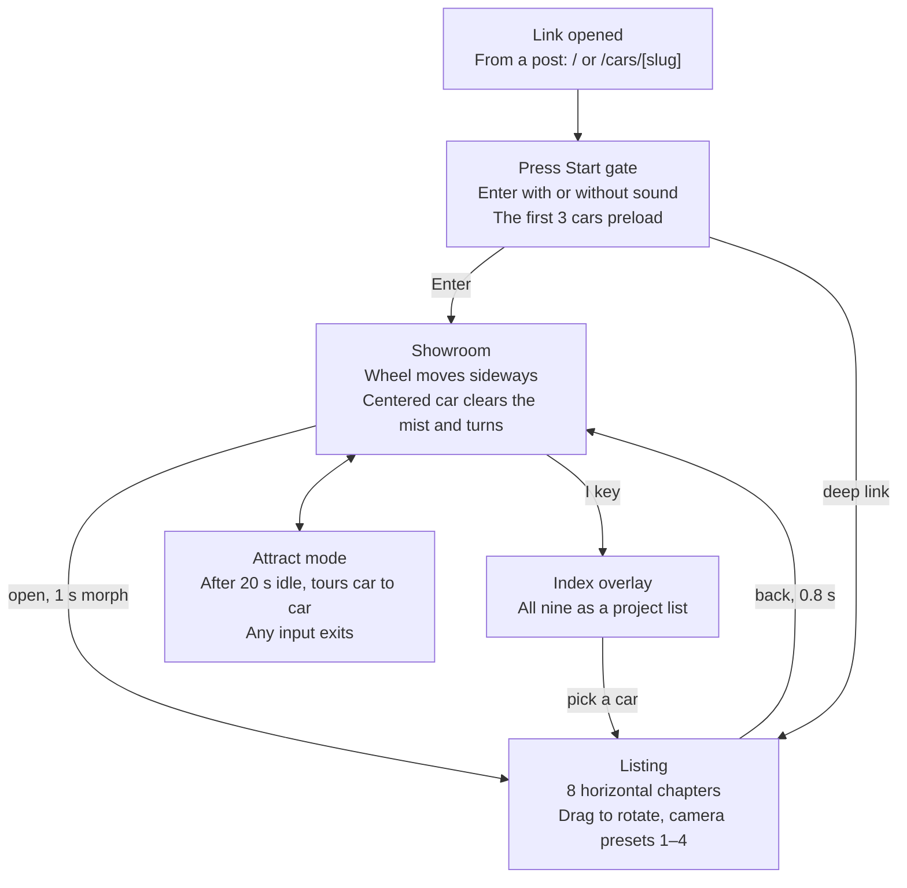
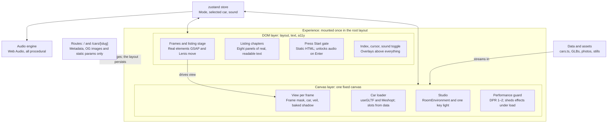

# Arcade — Technical PRD

> Repo mirror of the canonical PRD: https://claude.ai/code/artifact/6cbf5ebb-ec3a-4e80-a289-f0f3f3cb52ad
> As of 2026-10-04. The Claude Doc is where review and comments happen; if the two ever disagree, ask before building.
> Diagrams are Mermaid versions of the drawings in the doc.

## Overview

Arcade (codename Vanilla Arch) is a full-bleed, horizontally scrolling 3D showroom for secondhand enthusiast cars, built as a polished LinkedIn and X showcase with fictional listings.

**The problem.** Mainstream used-car marketplaces feel corporate and cram every field onto the page. Luxury boutiques go the other way but are often unpolished, or little more than a digital business card. We sit between them: enthusiast-first, curated information, presented with quiet authority.

**The idea.** Seller photos stay, but every listing gains a second, more objective entry point: a 3D model configured to the car's actual spec. A red car with a black interior renders as a red car with a black interior.

**The experience.** Cars sit in large geometric frames on a horizontal carousel that flows like [Agrumea Farm](https://www.agrumeafarm.it/en). Each car phases in out of a soft mist and turns slowly on a turntable once centered, after Gran Turismo 4's Arcade Mode. A click morphs the frame into the listing, where the same model stays beside the spec sheet and the seller's photos.

**The look.** Whites and grays, Bauhaus geometry, and the restraint of Dieter Rams, Kenya Hara and MUJI, with Monocle's editorial voice. Layouts borrow from architecture-firm portfolios; listing depth borrows from [Cars & Bids](https://carsandbids.com). Neumorphism appears only on secondary controls.

**The constraint.** It is display-only: fictional data, no accounts, no transactions. The build should land in 2–3 Claude Code passes after this plan, followed by a polish pass.

## Goals, non-goals and success metrics

Arcade wins if a visitor from a LinkedIn or X post opens at least one car and stays past a minute, and a petrolhead finds nothing wrong in the details.

**Goals**

1. **Showcase-grade interaction.** Every moment is gentle, interruptible and premium; nothing on screen is clutter.
2. **A second, more honest entry point.** Each car's 3D spec visibly matches its seller photos: paint, interior and wheels.
3. **Enthusiast credibility.** Nine real modern classics with correct chassis codes, plausible prices and Cars & Bids-depth listings.
4. **Unmistakable taste.** East-Asian editorial, Bauhaus geometry and Rams-style restraint, steering clear of the three default clusters the frontend-design skill warns about.
5. **Fast to build.** This plan, an asset-prep pass, 2–3 Claude Code build shots, then one polish pass.

**Non-goals**

- Real inventory, transactions, accounts, auctions, a CMS or an admin.
- Search and filters; the Index overlay covers the overview.
- Full Japanese localization; Japanese appears only as editorial accents.
- Gran Turismo assets, logos or music; GT4 is a reference for feel only.
- SEO growth. Per-car share cards are in scope; ranking is not.

**Success metrics**

| Metric | Target | Measured by |
| --- | --- | --- |
| Visitors who open at least one listing | ≥ 40% | Unique visitors to any `/cars/[slug]` page ÷ all unique visitors, in Vercel Web Analytics |
| Listings opened per visit | ≥ 1.5 | `/cars/[slug]` page views ÷ unique visitors |
| Gate pass rate (entered ÷ gate views) | ≥ 85% | Custom event `gate_enter`, which needs a Vercel Pro plan; unmeasured on Hobby |
| Largest Contentful Paint, p75 | ≤ 1.5 s desktop, ≤ 2.5 s mobile | Lighthouse in QA; Speed Insights if enabled |
| Interaction to Next Paint, p75 | ≤ 200 ms | Same |
| Carousel frame rate | 60 fps desktop, ≥ 45 fps on an iPhone 13-class phone | Manual profiling in Chrome and Safari |
| Design and motion gates | No P0/P1 in `/impeccable audit`; `review-animations` verdict is Approve | Audit protocol after every shot |
| Accessibility | Lighthouse accessibility ≥ 95; whole flow works by keyboard | Lighthouse plus a manual pass |

## Audience and key journeys

Three kinds of visitor matter, and most arrive on a phone, from a social feed, with sound off.

| Visitor | Arrives from | Wants | What it means for the build |
| --- | --- | --- | --- |
| The scroller: designers, recruiters, founders | A LinkedIn or X post, usually on a phone | A 20–60 second moment of craft | Gate readable in under 1.5 s; first car turning within 3 s; full mobile experience |
| The petrolhead | X, forums, group chats | Real specs, honest condition, the right details | Correct chassis codes and JDM market names; miles and km; flaws and service history up front |
| The craft reviewer: creative directors, design engineers | Your portfolio, on a desktop | To inspect motion, type and transitions | Interruptible transitions, no dropped frames, reduced-motion support, clean semantic DOM |

**Key journeys**

1. **Skim (phone, about 30 s).** Post link → gate → "Enter the showroom" → swipe through 3–4 cars → tap one → read two chapters → share or leave.
2. **Deep dive (desktop, 3–5 min).** Gate → wheel through all nine → hover clears the mist → open a listing → try the camera presets → read the condition report → browse the gallery → back to the carousel → Index → open a second car.
3. **Shared car link.** `/cars/nissan-skyline-gt-r-r34` → gate → the car emerges from the mist straight into its listing → "Back to showroom" lands on the carousel with that car centered.
4. **Recording (you).** `/?capture=16x9` → attract mode tours the showroom on a loop with no UI chrome, ready for a clean screen recording.

## Experience flow



A shared link can land straight on a listing; from there, Back or Esc always returns to the showroom with that car centered.

## Functional requirements

Twenty-seven requirements: the 22 P0s are the 2–3 shot build, and the five P1s land in the polish pass if time allows.

| ID | Area | Requirement | Priority | Acceptance criteria |
| --- | --- | --- | --- | --- |
| FR-01 | Gate | "Press Start" gate | P0 | Static wordmark on a misty gray field paints in under 1.5 s without waiting for JS; the first 3 cars preload behind it. "Enter the showroom" starts audio, "Enter without sound" stays muted, Enter key means with sound; the choice persists in localStorage. |
| FR-02 | Carousel | Horizontal showroom row | P0 | All 9 cars sit in Bauhaus frames on one full-bleed row. Wheel, trackpad (both axes), swipe, arrow keys, PageUp/PageDown and Home/End all move it horizontally, smoothed by Lenis. |
| FR-03 | Carousel | Soft snap | P0 | About 150 ms after input stops, the nearest car eases to center within 700 ms; snapping never fights active input. |
| FR-04 | Carousel | Mist phase-in | P0 | Each car's veil follows its distance from center: fully clear in the center band, fully misted at the edges; no hard pop-in at any scroll speed. |
| FR-05 | Carousel | Endless turntable | P0 | The centered car turns one revolution per 60 s, easing in over 1.2 s after it settles and out as it leaves; other cars hold a three-quarter pose. |
| FR-06 | Carousel | Hover | P0 | On fine pointers, hovering a frame clears its mist further, speeds the turntable 1.5× and shows a "View the car" pill cursor; touch devices skip hover. |
| FR-07 | Carousel | Frame label and emblem | P0 | Each frame shows No., year, make, model with chassis code and USD price; the centered car's small full-color emblem sits top-right of the viewport, GT4-style. |
| FR-08 | Navigation | Index overlay | P0 | An "Index" button and the `I` key open an architect-style project list (No., year, make, model, mileage in mi and km, price); rows link to listings; Esc closes and restores focus. |
| FR-09 | Transition | Frame-to-listing morph | P0 | Click, tap or Enter pushes `/cars/[slug]`; the frame grows into the listing stage in about 1 s while the car keeps turning; other cars recede into mist; Back mid-flight reverses it. |
| FR-10 | Transition | Back to showroom | P0 | Browser back, Esc or "Back to showroom" reverses the morph in about 0.8 s and lands on the carousel with that car centered. |
| FR-11 | Routing | Deep links | P0 | A direct load of `/cars/[slug]` opens the listing with an emerge-from-mist intro after the gate; unknown slugs get a styled 404. |
| FR-12 | Listing | Horizontal chapters | P0 | On desktop the listing scrolls horizontally, Normal is Boring-style: panels of varied width and gray tone, cut-off display type, vertical chapter spines, an 01–08 progress index. The 3D stage stays pinned on the left third through chapter 05. |
| FR-13 | Listing | Chapter set | P0 | 01 Overview, 02 The Take, 03 Specification, 04 Modifications (only when present), 05 Condition, 06 Provenance, 07 Gallery, 08 Enquire. |
| FR-14 | 3D | Stage controls | P0 | Drag rotates with inertia and hands back to the turntable after 2 s idle; Front, Side, Rear and ¾ presets move the camera in 800 ms; keys 1–4 trigger presets; no zoom. |
| FR-15 | 3D | Spec-accurate materials | P0 | Paint color and finish, interior color, wheel finish and caliper color come from listing data through named material slots, and pass a side-by-side check against the photo set. |
| FR-16 | Listing | Architectural elevation | P1 | Chapter 03 shows an orthographic side-elevation line drawing with dimension lines for length, wheelbase and height, rendered from the car's own model. |
| FR-17 | Listing | Auction-sheet condition report | P0 | Chapter 05 shows a top-down car outline with coded marks (A1 scratch, U1 dent, W1 repaint), each linked to a note and a photo, plus a signal-orange hanko-style grade seal such as 4.5 / B. |
| FR-18 | Listing | Gallery | P0 | 12–20 matched seller photos per car on a drag-or-scroll rail, a keyboard-navigable lightbox, and a credit line per photo. |
| FR-19 | Listing | Enquire (mock) | P1 | Name, email and message with inline validation and a calm success state; nothing is sent or stored, and the form says so. |
| FR-20 | Sound | Room tone and micro-sounds | P0 | A quiet room-tone loop; a soft tick when the snap settles, a breath on the morph, a paper slide on Index; no sound on hover or continuous scroll. Mute button and `M` key; audio pauses while the tab is hidden. |
| FR-21 | Capture | Attract mode | P1 | After 20 s idle on the carousel, the showroom tours itself, one car every 6 s; any input exits instantly. |
| FR-22 | Capture | `?capture` flag | P1 | Hides cursor and chrome, locks the frame to 16:9 or 4:5 (`?capture=16x9` or `?capture=4x5`), fixes DPR at 2, and keeps attract mode running until Esc. |
| FR-23 | Sharing | Share cards | P0 | Every route has a title, description and 1200×630 OG image (car still on the gray cyclorama plus its name); X uses `summary_large_image`; previews pass LinkedIn Post Inspector. |
| FR-24 | Mobile | Adapted flow | P0 | Native swipe carousel with snap; live 3D for the centered car only, stills for its neighbors; the listing becomes a vertical scroll under a sticky 3D header; tap targets ≥ 44 px. |
| FR-25 | Resilience | Fallbacks | P0 | Without WebGL2, in low-power mode or with reduced motion: pre-rendered stills, crossfades instead of morphs, a static ¾ pose. All text lives in the DOM, never only in the canvas. |
| FR-26 | Legal | Disclaimer and credits | P0 | Footer and `/credits` state that Arcade is a concept with fictional listings, unaffiliated with any manufacturer; every CC-BY model and photo is credited with author, link and license. |
| FR-27 | Analytics | Launch measurement | P1 | Vercel Web Analytics page views per route, so listing opens are `/cars/[slug]` views; no cookies, no banner. Custom events (`gate_enter` with sound on or off, `chapter_reached`, `index_open`, `attract_start`) sit behind a flag because they need a Pro plan. |

## Motion and interaction spec

Motion is slow where it carries meaning and instant where it repeats: the showroom breathes, the interface never lags.

**Easing tokens** (from Emil Kowalski's `emil-design-eng`): `--ease-out: cubic-bezier(0.23, 1, 0.32, 1)` for entries and settles, `--ease-in-out: cubic-bezier(0.77, 0, 0.175, 1)` for morphs and camera moves, `--ease-drawer: cubic-bezier(0.32, 0.72, 0, 1)` for the Index overlay. Linear is reserved for constant motion like the turntable. Never ease-in for UI.

| Moment | Trigger | Duration | Easing | Reduced motion |
| --- | --- | --- | --- | --- |
| Gate to showroom | Enter | 1200 ms | ease-in-out | 250 ms crossfade |
| Carousel scroll | Wheel, trackpad, swipe | Continuous | Lenis, lerp 0.09 | Native scroll, no smoothing |
| Snap settle | Input idle for 150 ms | 500–700 ms, by distance | ease-out | Instant |
| Mist veil | Scroll position | Continuous | smoothstep of distance | Unchanged (nothing travels) |
| Turntable | Car centered | 60 s per revolution, 1.2 s speed ramp | Linear, critically damped ramp | Static ¾ pose |
| Hover clear | Pointer enters frame | 240 ms in, 320 ms out | ease-out | Opacity only |
| Pill cursor | Pointer moves | Follows at lerp 0.18 per frame | — | Native cursor |
| Frame to listing | Click, tap, Enter | 1000 ms (900 ms frame, 40 ms chrome stagger) | ease-in-out; text ease-out | 250 ms crossfade |
| Listing to showroom | Back, Esc | 800 ms | ease-in-out | 200 ms crossfade |
| Camera preset | Button or keys 1–4 | 800 ms | ease-in-out | Cut |
| Drag release | Pointer up | Inertia decays about 0.92 per frame; turntable resumes after 2 s | — | No inertia |
| Index overlay | `I` or button | 320 ms open, 220 ms close | ease-drawer, ease-out | Fade only |
| Text reveal | Chapter enters view | 600 ms, 30 ms per line | ease-out | None |
| Button press | Pointer down | 120 ms to scale 0.97 | ease-out | None |

**The veil, precisely**

```ts
// d: 0 when the frame is centered, 1 when its center reaches the viewport edge
const d = Math.abs(frameCenterX - viewportCenterX) / (viewportWidth / 2);
const veil = smoothstep(0.18, 0.85, d);     // 0 = clear, 1 = lost in mist
const shown = hovered ? veil * 0.7 : veil;  // hover clears another 30%
```

**Rules every shot follows**

- DOM animates only `transform`, `opacity` and `filter: blur()` up to 8 px; the 3D layer animates uniforms and the camera, never layout.
- Every interactive animation is interruptible: GSAP timelines reverse from their current progress; CSS keyframes only for non-interactive loops.
- Exits run faster than entries, so the listing leaves in 800 ms and arrives in 1000 ms.
- High-frequency actions get no animation: Index row hover, focus moves, repeated arrow-key steps.
- Hover effects live behind `@media (hover: hover) and (pointer: fine)`.
- Reduced motion keeps opacity and color changes and removes travel.

**Car frame states**

| State | What the visitor sees | Leaves when |
| --- | --- | --- |
| Offstage | Nothing; the view is not rendered | It scrolls within one frame of the viewport |
| Approaching | Car veiled in mist; frame relaxed toward a neutral tall portal (P1 morph) | It enters the center band |
| Centered | Clear car, signature frame shape resolved, turntable running, emblem shown | Scrolled away, hovered or selected |
| Hovered | Mist cleared further, turntable at 1.5×, pill cursor | Pointer leaves or clicks |
| Selected | Frame morphing into the listing stage while the others recede | The morph completes, or Back reverses it |
| Listing | Pinned stage with drag and camera presets | Back, Esc or an Index pick |
| Returning | Reverse morph into its slot | It lands centered |

## Content model and information architecture

Four routes, one typed data file and thirteen cars. There is no backend: every listing is fiction written to read like fact.

| Route | Purpose | Rendering |
| --- | --- | --- |
| `/` | Gate, then the showroom carousel | Static shell; the client experience lives in the root layout |
| `/cars/[slug]` | One listing; 13 slugs | Static via `generateStaticParams`, with per-car metadata and OG image |
| `/credits` | Model, photo and font credits, plus the disclaimer | Static |
| 404 | Styled not-found page | Static |

The Index is an overlay on any route, not a page.

**The lineup.** Ordered by year, so the showroom reads like an archive. Shot 0 fixed each car's colorway, year, variant and location to match its licensed photo set (one physical car per set), and the 3D model is configured to match. Prices and mileage are fictional but market-plausible. `lib/cars.ts` is the source of truth; details and sources are in `docs/shots/shot-0.md`.

| No. | Car | Japanese accent | Frame | Paint / interior | Price | Mileage | Location | 3D model (CC-BY) |
| --- | --- | --- | --- | --- | --- | --- | --- | --- |
| 01 | 1975 Datsun 240K GT (C110), Kuwait-delivered | ケンメリ スカイライン | Arch | Silver Blue Metallic / Black vinyl | $38,500 | 88,900 mi | Utrecht, Netherlands | [Lionsharp Studios](https://sketchfab.com/3d-models/b2303a552b444e5b8637fdf5169b41cb) (CC BY-SA) |
| 02 | 1972 Triumph TR6 (CP), 150 bhp injection | トライアンフ TR6 | Circle | Pure White / Black leather | $34,000 | 61,200 mi | Baden-Württemberg, Germany | [Alexios_Apokaukos](https://sketchfab.com/3d-models/69e5de3f68804fbc900557b7740b680c) |
| 03 | 1976 Porsche 911 Turbo (930), 3.0 | ポルシェ 930 ターボ | Square | Copper Brown Metallic / Tan leather | $245,000 | 54,300 mi | Düsseldorf, Germany | [Lionsharp Studios](https://sketchfab.com/3d-models/8568d9d14a994b9cae59499f0dbed21e) |
| 04 | 1993 Peugeot 205 CJ | プジョー 205 カブリオレ | Half-disc | Blanc Meije / Grey cloth | $9,800 | 68,400 mi | Barcelona, Spain | [maxipub](https://sketchfab.com/3d-models/ff2b04cf7da94cbdbd277fe23b7204b8) |
| 05 | 1991 Honda NSX (NA1), automatic | ホンダ NSX | Arch | Formula Red / Black leather | $92,000 | 58,600 mi | Leicestershire, England | [Lexyc16](https://sketchfab.com/3d-models/honda-nsx-1990-1cc15628a00a4739a6b6c01128927c8d) |
| 06 | 1993 Jaguar XJ220 | ジャガー XJ220 | Circle | Maroon metallic / Cream leather | $585,000 | 3,900 mi | Lakeland, Florida | [comrade1280](https://sketchfab.com/3d-models/jaguar-xj220-1991-d99bb7b0fc0e4e3c9553246679dd067f) |
| 07 | 1997 Honda Integra Type R (DB8) | インテグラ タイプR | Square | Championship White / Black | $46,000 | 82,300 mi | Saitama, Japan | [myedsu](https://sketchfab.com/3d-models/honda-integra-db8-type-r-06f0eba84e9745e9aec41a985ccac915) |
| 08 | 1999 Lotus Elise Sport 135 (S1) | ロータス エリーゼ | Half-disc | Silver metallic / Pink Corbeau seats | $36,500 | 47,800 mi | Norfolk, England | [sa3d](https://sketchfab.com/3d-models/75e9045ac1af4cdbb69318108c81edfd) |
| 09 | 1998 Fiat Barchetta | フィアット バルケッタ | Arch | Rosso Speed / Black cloth | $12,500 | 54,100 mi | Pinerolo, Italy | [ngon_3d](https://sketchfab.com/3d-models/1f4a33656cca442885dc708c38bb3332) |
| 10 | 2002 Subaru Impreza WRX Wagon (GG) | インプレッサ WRX ワゴン | Circle | WR Blue Pearl / Black cloth | $14,900 | 118,400 mi | Edmonton, Canada | [ilvskf](https://sketchfab.com/3d-models/fa2c8e1d265443e982b90f964c2b3e02) |
| 11 | 2002 BMW M5 (E39) | BMW M5 | Square | Carbon Black Metallic / Black leather | $36,500 | 96,200 mi | Kent, England | [BlackSnow02](https://sketchfab.com/3d-models/bmw-e39-free-531a5a93da5d493d9918eb36f011c20d) |
| 12 | 2008 Lamborghini Gallardo LP 560-4 | ランボルギーニ ガヤルド | Half-disc | Nero / Nero leather | $129,000 | 21,400 mi | Flanders, Belgium | [temp0.crazy](https://sketchfab.com/3d-models/lamborghini-gallardo-2010-ff0eb2242d0e42eb8b7034b4db639e56) |
| 13 | 2007 Mazda MX-5 (NC) | マツダ ロードスター | Arch | Brilliant Black / Black leather | $11,900 | 52,700 mi | Brisbane, Australia | [Res1n](https://sketchfab.com/3d-models/96056443d55c4afaa90099e9e1d45d9b) |

**Chapters per listing**

| Chapter | What it holds | Data |
| --- | --- | --- |
| 01 Overview | Huge cut-off Didone name, year, chassis code, price, mileage in mi and km, location; the Japanese market name set vertically in Mincho | Core fields |
| 02 The Take | One 80–120 word house-curator paragraph in a Monocle tone, plus one pull quote | `take` |
| 03 Specification | Spec sheet in mono numerals, the architectural elevation drawing, the equipment list | `spec`, `equipment` |
| 04 Modifications | Only for modified cars (the Eunos Roadster) | `modifications` |
| 05 Condition | Auction-sheet diagram with coded marks, the signal-orange grade seal, flaw notes with photos | `condition` |
| 06 Provenance | Owners, a service-history timeline, items included in the sale | `provenance` |
| 07 Gallery | 12–20 matched seller photos on a rail | `photos` |
| 08 Enquire | Mock form, the concept note, and links to the previous and next car | — |

Condition marks use the standard Japanese auction-sheet vocabulary: A for scratches, U for dents, W for repaired or wavy panels, S for rust and X for parts needing replacement, each with a severity digit.

**Data schema** (`lib/cars.ts`, one typed array; no CMS). This is the planning sketch; the implemented types in `lib/cars.ts` win. Shot 0 changes: the pipeline renames model materials to the slots below (mapping in `content/models.json`), so cars no longer carry `slots`; specs store official PS, kW, hp, N·m and lb-ft figures; `marketName` and `steering` were added; photos and model credits load from `content/photos.json` and `content/models.json`.

```ts
export type FramePrimitive = 'arch' | 'circle' | 'square' | 'half-disc';
export type MaterialSlot =
  | 'paint' | 'glass' | 'interior' | 'trim' | 'chrome' | 'rubber'
  | 'rim' | 'caliper' | 'lamp' | 'lamp-emissive' | 'plate';

export interface Car {
  slug: string;                       // 'nissan-skyline-gt-r-r34'
  no: number;                         // 1-9, showroom order
  year: number; make: string; model: string; chassis: string;
  marketNameJa?: string;              // vertical Mincho accent
  frame: FramePrimitive;
  priceUsd: number; mileageMi: number; location: string;
  spec: {
    engine: string; powerHp: number; torqueLbFt: number;
    transmission: string; drivetrain: 'FR' | 'MR' | 'FF' | 'AWD';
    weightKg: number; lengthMm: number; widthMm: number;
    heightMm: number; wheelbaseMm: number;
  };
  colors: {
    paint: { name: string; hex: string; finish: 'solid' | 'metallic' | 'pearl' | 'matte' };
    interior: { name: string; material: string; hex: string };
    wheels: { name: string; hex: string; metalness: number };
    calipers?: { hex: string };
  };
  take: string;                       // house curator voice, 80-120 words
  highlights: string[]; equipment: string[]; modifications?: string[];
  condition: {
    grade: string;                    // e.g. '4.5'
    interior: 'A' | 'B' | 'C' | 'D';
    marks: { code: string; x: number; y: number; note: string; photo?: string }[];
  };
  provenance: {
    owners: number;
    service: { date: string; mileageMi: number; work: string }[];
    itemsIncluded: string[];
  };
  photos: { src: string; alt: string; kind: 'exterior' | 'interior' | 'detail' | 'flaw';
            credit: string; license: string; sourceUrl: string }[];
  model3d: { src: string; author: string; license: 'CC-BY-4.0'; sourceUrl: string;
             slots: Record<string, MaterialSlot> };  // source material name -> slot
}
```

## Design system

A gallery, not a store: white and stepped grays, one Braun signal orange, Didone headlines over a grotesk that does the work, and the cars as the only real color.

**Typography.** All four families are OFL, self-hosted through `next/font`, and exposed as CSS variables so licensed PP Editorial New and Neue Montreal can drop in later without code changes.

| Role | Typeface | Variable | Used for |
| --- | --- | --- | --- |
| Display | Bodoni Moda, optical size 96, roman and italic | `--font-display` | Car names, chapter statements, giant cut-off words |
| Text and UI | Host Grotesk (fallback Hanken Grotesk) | `--font-text` | Body, labels, buttons, the Index |
| Numerals | Geist Mono, tabular | `--font-mono` | Prices, mileage, spec values, chapter numbers |
| Japanese accents | Shippori Mincho | `--font-ja` | Market names and vertical chapter spines |

Scale: cut-off words `clamp(6rem, 16vw, 20rem)`; car names `clamp(3.5rem, 8vw, 9rem)`; section heads `clamp(2rem, 3.5vw, 3.5rem)`; body 17 px at 1.6 line height; labels 12 px uppercase at +0.08 em; mono 13 px.

**Color.** Achromatic UI; the car paint and the small full-color emblems carry all saturation.

| Token | Value | Role |
| --- | --- | --- |
| `paper` | #FFFFFF | Main background |
| `mist-100` | #F2F2F2 | Panels, cyclorama center |
| `mist-200` | #E6E6E6 | Neumorphic control surface |
| `mist-300` | #D4D4D4 | Cyclorama edge, hairline rules |
| `mist-500` | #9A9A9A | Decorative type at 24 px and up only |
| `mist-700` | #5C5C5C | Secondary text (6.7:1 on white) |
| `ink` | #161616 | Primary text, primary buttons, focus rings |
| `night` | #0E0E0E | Dark chapter panels, as in Normal is Boring |
| `signal` | #EE6A1F | Braun signal orange: grade seal, live dot, active chapter, cursor dot |
| `signal-text` | #C2541B | Rare inline emphasis (4.6:1 on white) |

**The One Signal Rule.** Signal orange covers at most 2% of any screen and never carries body text. It reaches only 3.1:1 on white and less on grays, so focus rings are 2 px `ink` with a 2 px offset, and orange is never the only indicator of state.

**Shapes.** Car frames use four Bauhaus primitives: arch, circle, square and half-disc. Each is generated as a 128-point outline, so any frame can morph into another. Panels and photos have square corners for architectural crispness; buttons and the cursor are full pills.

**Depth and neumorphism.** Soft extrusion appears only on secondary controls: sound toggle, camera presets, Index button and chapter pill. Use a `mist-200` surface with `-6px -6px 14px rgba(255,255,255,.9), 6px 6px 14px rgba(0,0,0,.07)`, inset when pressed. Each such control also gets a text label or a 1 px `mist-300` hairline to meet the 3:1 non-text contrast rule. Primary actions stay flat ink pills.

**Layout.** Horizontal panels are sized in viewport units (33, 50, 66 and 100 vw) on an 8 px spacing base, with 24 px margins on phones and 40 px on desktop. Carousel frames are 62–70 vh tall. Chapter spines are 56 px wide with vertical Mincho.

**3D staging.** Cars sit on a soft gray cyclorama, a radial gradient from `mist-100` to `mist-300`, as in GT4's studio. A baked contact shadow replaces any floor line. Seller photos stay unretouched: they are the subjective view the 3D model counterweights.

**Cursor.** An ink pill with a small signal dot and a contextual label: "View the car", "Drag", "Back". Hidden on touch; the native cursor returns under reduced motion.

**Sound.** Every sound is synthesized with the Web Audio API, so nothing needs licensing. Levels are starting points to tune by ear.

| Sound | When | Character | Start level |
| --- | --- | --- | --- |
| Room tone | Continuously after Enter | Filtered brown noise with faint air | −42 dBFS |
| Snap tick | A car settles at center | 12 ms filtered click | −30 dBFS |
| Breath | Frame-to-listing morph | 600 ms band-passed noise swell | −28 dBFS |
| Paper slide | Index opens or closes | 180 ms noise sweep | −32 dBFS |
| Press | Buttons | 8 ms soft click | −34 dBFS |

**Voice.** The house curator is precise, warm and a little wry: numbers over adjectives, no hype words, sentences under 20 words. UI labels: "Enter the showroom", "Enter without sound", "View the car", "Back to showroom", "Index", "Enquire".

**How the project's Claude Skills apply**

| Skill | Used for | When |
| --- | --- | --- |
| `frontend-design` | The design plan (palette, type, layout, signature) and its self-critique | Before shot 1 and for every new surface |
| `impeccable` | PRODUCT.md and DESIGN.md context; `critique`, `audit`, `polish`, `typeset`, `layout`, `animate`, `harden`, `optimize`; design-check hooks on every UI edit | Every shot; hooks on during the build |
| `emil-design-eng`, `animate`, `review-animations`, `improve-animations` | Motion decisions and the motion gate (verdict must be Approve) | Shots 1–3 and polish |
| `web-design-guidelines` | Vercel's Web Interface Guidelines review | Before deploy |
| `state-machine`, `loading-states`, `gesture-patterns`, `navigation-patterns`, `fitts-law`, `doherty-threshold` | Frame states, the gate, drag and swipe, the Index, target sizes, response times | While building each part |
| `mobile-native`, `break-ui` | Phone polish and a worst-case data stress test | Shot 3 |
| `ux-writing`, `content-research-writer` | Listing copy, The Take, spec accuracy with sources | Shot 0 content |
| `karpathy-guidelines`, `kaizen` | Coding discipline: simple, surgical, verified | Always |
| `case-study`, `presentation-deck` | The portfolio write-up and launch post | After launch |

## Technical architecture

One persistent WebGL canvas renders every car, and the DOM owns layout, text and accessibility. GSAP moves the DOM; the 3D views follow it.



Routes only set metadata, so a URL change never remounts the canvas; the store is the one place both layers read and write.

| Layer | Choice | Version on 2026-10-04 | Why |
| --- | --- | --- | --- |
| Framework | Next.js App Router on React | 16.3.8 / 19.3.0 | Static per-car routes, metadata and OG images; layouts persist across navigations |
| 3D | three via @react-three/fiber and @react-three/drei | 0.186.1 / 9.8.1 / 10.7.9 | `View` for multi-viewport, `useGLTF` with Meshopt and KTX2, `Mask`, `PerformanceMonitor` |
| Renderer | WebGLRenderer (WebGL2) | — | Works everywhere; the three.js manual still calls WebGPURenderer experimental |
| Motion | GSAP with ScrollTrigger, Flip, SplitText and MorphSVG | 3.15.0 | Every plugin is free, including for commercial use, since 3.13 |
| Scroll | Lenis with `lenis/snap` | 1.3.26 | Smooth wheel-to-horizontal mapping, and snapping that cooperates with smoothing |
| State | zustand | 5.0.15 | One store shared by the DOM tree and the canvas tree |
| Styling | Tailwind CSS with CSS-variable tokens | 4.3.3 | Tokens mirror DESIGN.md |
| Audio | Web Audio API, about 150 lines | — | Procedural sounds, no files to license |
| Assets | gltf-transform CLI, Meshopt, KTX2 | 4.5.1 | Model and texture compression |
| Debug | lil-gui behind `#debug` | 0.21.0 | Bruno Simon-style live tuning of veil, speeds and materials |
| Runtime | Node 24 LTS, TypeScript strict | 24.6 locally | — |
| Hosting | Vercel on a vercel.app URL, with Web Analytics | — | A preview URL for every shot |

**How it works**

1. **Persistent stage.** `app/layout.tsx` mounts `<Experience />`, a client root holding a fixed full-screen `<Canvas>` with `<View.Port />` plus every DOM surface: gate, carousel, listing and Index. Pages only declare metadata and static params, and layouts persist across navigations, so nothing 3D remounts when the URL changes.
2. **DOM drives, 3D follows.** Each frame, and the listing stage, is a DOM element tracked by a drei `<View>`. GSAP animates the element; the scissored view follows it every frame. Views more than one frame outside the viewport skip rendering.
3. **Frame masks.** The visible frame shape is a stencil mask built from the 128-point outline with drei's `Mask` and `useMask`; morphing a frame interpolates those points.
4. **Veil.** A per-view uniform drives fog toward the cyclorama color plus a full-view mist quad, using the formula in the motion spec.
5. **Materials.** Each model keeps its author's materials; the pipeline bakes the repairs into the file (transmission replaced by clear or tinted glossy lenses, near-opaque glass made see-through, matte tyres, no clear coat on black trim and interiors). At runtime only `paint` is replaced, from the listing (`lib/materials.ts`): solid paint is pigment under a clear coat (specular off, clearcoat 1, clearcoat roughness 0.02); metallic paint keeps metalness 0.6.
6. **Lighting.** Poly Haven's `studio_small_09` at 1K with a dark floor, a narrow overhead softbox and two side strips, rendered once per renderer into one shared environment map (`components/three/StudioLook.tsx`), plus one soft key light, under ACES. Each car gets a baked top-down shadow texture on a plane that turns with it.
7. **The morph.** On select, GSAP Flip animates the frame element into the listing-stage rect while `router.push` updates the URL and the store switches the chrome to listing mode; Back runs the timeline in reverse. React's `<ViewTransition>` now works in Next 16.3 without config, but it is used only for DOM-only crossfades; the 3D morph stays on Flip because the canvas lives outside page snapshots.
8. **Horizontal scroll.** On desktop the document scrolls vertically while a pinned track translates sideways (Lenis plus ScrollTrigger), keeping native keyboard and scrollbar behavior; `gestureOrientation: 'both'` accepts sideways trackpad swipes too. Carousel and listing each own a Lenis instance; only the active one runs, and the carousel's position is restored on return. Phones use a native `overflow-x` scroller with `scroll-snap-type: x mandatory`.
9. **Loading.** The gate is static HTML and CSS. Cars 1–3 load behind it, the rest stream in carousel order during idle time, and the next car in either direction is always preloaded.
10. **Performance guard.** `PerformanceMonitor` steps DPR between 1 and 2 (1.5 on phones) and sheds the mist quad and shadow resolution under load; rendering pauses while the tab is hidden.
11. **Share cards.** WebGL cannot run inside `ImageResponse`, so a Playwright script renders each car's still at build time and `opengraph-image` composes the still with the car's name.

**Keyboard map:** ← and → step between cars, Enter opens, Esc goes back, `I` toggles the Index, `M` mutes, 1–4 pick camera presets.

**Folder layout**

```
app/
  layout.tsx                 fonts, <Experience />, base metadata, Analytics
  page.tsx                   home metadata
  cars/[slug]/page.tsx       generateStaticParams + generateMetadata
  cars/[slug]/opengraph-image.tsx
  credits/page.tsx
components/experience/
  Experience.tsx             client root: canvas plus every DOM surface
  Stage.tsx                  <Canvas>, View.Port, PerformanceMonitor, studio
  CarView.tsx                one View: frame mask, car, veil, shadow
  Car.tsx                    useGLTF plus material-slot mapping
  Gate.tsx  Carousel.tsx  IndexOverlay.tsx  Cursor.tsx  SoundToggle.tsx
  listing/                   Overview, Take, Spec, Elevation, Modifications,
                             Condition, Provenance, Gallery, Enquire
lib/
  cars.ts  store.ts  audio.ts  motion.ts  frames.ts  analytics.ts
public/
  models/  photos/  stills/  emblems/
scripts/
  optimize-models.mjs        gltf-transform pipeline
  render-stills.mjs          Playwright: OG cards and fallback stills
```

## 3D asset pipeline

Nine models from six modelers become one collection by passing through the same eight steps and the same budgets.

1. **Download and credit.** Fetch each GLB from Sketchfab and record author, link and license (CC-BY 4.0) in `cars.ts` and on `/credits`.
2. **Check provenance.** Reject game rips and unverified re-uploads, such as descriptions naming a game or texture names from game files. All nine picks passed a first look; recheck on download.
3. **Normalize.** Meters, +Y up, nose toward +Z, origin on the ground midway between the axles. Apply transforms; strip plates, stands and scene props.
4. **Rename materials to slots:** `paint`, `glass`, `interior`, `trim`, `chrome`, `rubber`, `rim`, `caliper`, `lamp`, `lamp-emissive`, `plate`. The mapping lives in `cars.ts`.
5. **Fix poses.** Lower the pop-up headlights where the model allows; the NSX, RX-7 and MX-5 ship with them raised.
6. **Optimize** with gltf-transform (below). Keep `--palette false` so materials are not merged into palette textures, and `--join-named false` so wheels and pop-ups stay addressable.
7. **Bake** one 512 × 512 top-down soft shadow per car from an orthographic render.
8. **Render stills** with Playwright from the live scene: 1200 × 630 OG cards, phone-neighbor stills and no-WebGL fallbacks, so stills always match the 3D spec.

```bash
npx @gltf-transform/cli optimize raw/nsx.glb public/models/nsx.glb \
  --compress meshopt --texture-compress webp --texture-size 1024 \
  --simplify true --simplify-ratio 0.6 --simplify-error 0.001 \
  --palette false --join-named false
```

WebP keeps the toolchain simple. Switch `--texture-compress` to `ktx2` (needs KTX-Software installed) if phone GPU memory gets tight.

The desktop model figures are a loose guideline, not a cap (decision log, 2026-10-10): this is a desktop showcase, and the hero files ship up to about 400k triangles and 4.5 MB (the Datsun, 4.49 MB). The real gate is the frame rate.

| Budget | Desktop | Phone |
| --- | --- | --- |
| GLB per car | Guideline: hero files up to about 4.5 MB (was ≤ 2.5 MB) | ≤ 1 MB (lighter LOD) |
| Triangles per car | Guideline: up to about 400k (was ≤ 120k) | ≤ 40k |
| Draw calls per car | ≤ 25 | ≤ 15 |
| Textures | ≤ 1024 px | ≤ 512 px |
| First view: 3 cars plus app JS | ≤ 6 MB | ≤ 3 MB |
| Cars rendered live at once | Up to 4 | 1; neighbors are stills |

| Car | Source model | Prep needed |
| --- | --- | --- |
| MX-5 (NA) | 52k tris, 1.8 MB | Lower pop-ups; British Racing Green paint, tan interior slot |
| NSX (NA1) | 101k tris, 6.3 MB | Lower pop-ups; compress textures |
| XJ220 | 39k tris, 10.1 MB of 2K textures | Downsize textures to 1K |
| RX-7 (FD3S) | 37k tris, 5 MB | Lower pop-ups |
| M3 (E36) | 67k tris, 4.9 MB | Keep stance and wheels for the Modifications chapter; remove the Japanese plate |
| Integra Type R (DB8) | 25k tris, 3 MB | Remove the Japanese plate; check interior detail through the glass |
| Skyline GT-R (R34) | 62k tris, 4.8 MB | Minor cleanup |
| M5 (E39) | 287k tris, 10.9 MB | Simplify by about 60%. Verify M5 cues (wheels, bumpers); if they're missing, list the car as a 540i Sport instead |
| Gallardo LP560-4 | 155k tris, 15.6 MB | Simplify by about 30%; textures to 1K; matte paint finish |

## Non-functional requirements

The bar is a real site's bar: fast on a mid-range phone, complete by keyboard, and honest about licenses.

**Performance**

| Metric | Target |
| --- | --- |
| Largest Contentful Paint (the gate wordmark) | ≤ 1.5 s on desktop broadband; ≤ 2.5 s on a mid-range phone over 4G |
| First car turning, from first byte | ≤ 3 s desktop; ≤ 5 s phone over 4G |
| Interaction to Next Paint | ≤ 200 ms |
| Cumulative Layout Shift | ≤ 0.02 |
| Frame rate | 60 fps on Apple M1 or RTX-class desktops; ≥ 45 fps on iPhone 13 or Pixel 7 in the carousel |
| Initial JavaScript, gzipped | ≤ 350 KB including three and GSAP |
| GPU memory | ≤ 400 MB desktop; ≤ 200 MB phone |

**Accessibility** (WCAG 2.2 AA wherever it applies)

- Every car frame is a real `<a href="/cars/[slug]">` named like "1993 Mazda RX-7 (FD3S), $64,000". The canvas is `aria-hidden`, and every fact the 3D shows (paint, interior) also exists as text.
- The whole flow works by keyboard, with visible focus that is never obscured: focusing a frame scrolls it to center (WCAG 2.4.11).
- Horizontal scroll gets explicit affordances: a scroll hint, a progress index, and the Index overlay as a linear alternative. That answers [Adrian Roselli's critique](https://adrianroselli.com/2025/08/horizontal-scrolling-containers-are-not-a-content-strategy.html) of horizontal scrollers.
- Reduced motion stops the turntable at ¾, turns transitions into crossfades, disables Lenis smoothing and skips attract mode.
- Text contrast is at least 4.5:1, so small text is `mist-700` or darker; non-text UI is at least 3:1, neumorphic controls included.
- Sound never plays before a gesture, has a visible mute plus the `M` key, and remembers the choice.
- At 200% zoom, or below 1024 CSS px, the listing reflows vertically (WCAG 1.4.10). Touch targets are at least 44 × 44 px.

**Sharing and search.** Each route has a unique title and description, a 1200 × 630 OG image as a JPG under 300 KB, `twitter:card` set to `summary_large_image`, and a canonical URL. Check every card in LinkedIn Post Inspector before posting, since LinkedIn caches previews.

**Security and privacy.** Static site, no cookies, no stored personal data; the enquiry form never transmits. Vercel Web Analytics is cookieless. Headers: a strict CSP (self plus Vercel's analytics endpoint), `Referrer-Policy: strict-origin-when-cross-origin`, `X-Content-Type-Options: nosniff`. Ship with no high-severity `npm audit` findings.

**Browser support.** The last two versions of Chrome, Edge, Firefox and Safari (macOS, and iOS 17 or later). Live 3D needs WebGL2; everything else falls back to stills.

**Licensing.** Models are CC-BY 4.0 and credited; photos follow their own licenses and are credited per image; fonts are OFL. Manufacturer emblems are used nominatively under a non-affiliation disclaimer. No Gran Turismo assets or music.

## Infrastructure, environments and operations

Static Next.js on Vercel's free Hobby tier: no servers, no secrets, no database.

| Concern | Decision |
| --- | --- |
| Repository | Local git, initialized with the skills and this PRD; add a GitHub remote when you want Vercel's Git integration |
| Hosting | A Vercel project on a vercel.app subdomain such as `arcade-showroom.vercel.app` (availability not yet checked) |
| Environments | Local `next dev` with Turbopack; a Vercel preview per shot via `vercel deploy`; production via `vercel deploy --prod` |
| Secrets | None; no environment variables needed |
| Caching | Models, photos and stills use content-hashed names with `Cache-Control: public, max-age=31536000, immutable` |
| Analytics | `@vercel/analytics` page views per route, so every `/cars/[slug]` view counts as a listing open. [Custom events need a Pro plan](https://vercel.com/docs/analytics/custom-events), so `gate_enter`, `chapter_reached`, `index_open` and `attract_start` are wired behind a flag and only report if you upgrade |
| Monitoring | Speed Insights optional; zero console errors is a release gate |
| Checks | `npm run check` runs typecheck, lint, build and the Playwright smoke suite; Lighthouse runs before any preview is shared |
| Tools to install | Vercel CLI (`npm i -g vercel`). Blender is optional, for pop-up and plate fixes; KTX-Software only if KTX2 textures are needed |

## Delivery plan, QA and audit protocol

One asset-prep pass and three build shots, each ending at a gate, then a polish pass before the LinkedIn and X launch.


Phases are drawn equal because no dates are set yet; a shot that misses its gate is fixed before the next one starts.

1. **Shot 0: assets and scaffold.** This is preparation, outside the 2–3 build shots. Turn on Impeccable's hooks first, then scaffold the Next.js app with tokens and fonts. Download, normalize, slot and compress all nine models. Source and license 12–20 matched photos per car. Write `cars.ts`: specs, takes, condition and provenance. Render the stills.
    - Gate: all nine GLBs within budget and visually matched to their photo sets; data and credits complete.
2. **Shot 1: the showroom.** Persistent canvas, gate with audio unlock, desktop carousel with Lenis and soft snap, Bauhaus frames as static shapes, the veil, the turntable, hover and pill cursor, the Index overlay, the sound engine and emblems.
    - Gate: nine cars at 60 fps on desktop; `/impeccable critique` and `review-animations` pass.
3. **Shot 2: listings and the morph.** Frame-to-listing morph and back, deep links, horizontal Normal is Boring-style chapters, stage controls, Specification with elevation, Condition with the seal, Provenance, Gallery with lightbox, and the mock Enquire.
    - Gate: the full desktop flow works; `review-animations` says Approve; `/impeccable audit` has no P0.
4. **Shot 3: mobile, resilience and ship.** Phone flow, reduced motion, stills fallback, OG cards, credits and disclaimer, attract mode and `?capture`, analytics, performance tuning, an accessibility pass, deploy.
    - Gate: the device matrix passes; Lighthouse accessibility ≥ 95; every NFR budget is met.
5. **Polish pass.** `/impeccable polish`, the P1 frame morph between primitives, sound mixing, a copy edit, the launch recording with `?capture`, a LinkedIn Post Inspector check, then post.

**Audit protocol after every shot**

1. `frontend-design` self-critique: is every choice specific to this subject, or would it fit any project?
2. Impeccable's hooks check every UI edit during the shot; at the end, run `/impeccable critique` and `/impeccable audit` and fix every P0 and P1.
3. Emil Kowalski's `/review-animations` on the shot's motion; it is command-only, so you type it at each gate. The verdict must be Approve, not Block.
4. Shot 3 and polish add `web-design-guidelines` (Vercel's Web Interface Guidelines) and `break-ui` on the listing data.
5. `karpathy-guidelines` governs the code: the smallest change that meets the requirement, then verified.

**QA**

- Automated: TypeScript strict, lint, `next build`, a Playwright smoke suite (gate, carousel, open listing, back; deep link; keyboard-only path; reduced-motion path), axe-core on the gate, carousel and a listing, and Lighthouse.
- Spec check: for every car, a 3D still beside a seller photo from the same angle, comparing paint, interior through the glass, and wheels.

| Device | Browser | Input |
| --- | --- | --- |
| MacBook, Apple silicon | Safari and Chrome | Trackpad |
| Windows laptop | Chrome and Edge | Mouse wheel and trackpad |
| iPhone 13 or newer | Safari | Touch |
| Pixel 7-class Android | Chrome | Touch |
| iPad | Safari | Touch and trackpad |

## Risks, assumptions and open questions

The biggest risks are content, not code: matching photos to models, and making nine 3D cars from different hands look like one collection.

| Risk | Likelihood | Impact | Mitigation |
| --- | --- | --- | --- |
| Licensed photo sets matching an exact model and color are scarce | High | High | Search Unsplash, Wikimedia Commons, Pexels and Flickr CC-BY; let the 3D color follow the photos; accept 8–12 photos when 20 don't exist; swap a car if no set exists (backups: Lancia Delta Integrale, Mitsubishi Evo VI) |
| Models differ in scale, detail and material naming | High | Medium | Canonical slots, one studio, one veil, a QA still per car; extra time in Shot 0 |
| Phone GPUs and iOS Safari memory limits | Medium | High | One live car on phones, lighter LODs, DPR capped at 1.5, off-screen models disposed, stills elsewhere |
| Scope versus the 2–3 shot budget | High | Medium | P0/P1 split; Shot 0 absorbs the asset work; P1 waits for polish |
| Horizontal scroll confuses some visitors | Medium | Medium | Wheel mapping, keyboard support, a scroll hint, the Index overlay |
| Sound on by default annoys people | Medium | Low | The gate offers "Enter without sound", levels stay low, `M` mutes, the choice persists |
| Manufacturer emblems and trademarks | Low | Medium | Nominative use, a non-affiliation disclaimer, a non-commercial portfolio piece, removal on request |
| A model turns out to be a game rip | Low | High | Provenance check on download; replace on any doubt |
| Vercel Hobby has no custom events | Certain | Low | Route page views cover listing opens; events stay behind a flag |
| The E39 model lacks M5 cues | Medium | Low | List it as a 540i Sport instead |

**Assumptions**

- Listings, prices, mileage, owners and flaws are fictional; makes, models and specs are factual.
- English UI with Japanese accents; prices in USD; mileage in miles and kilometers.
- No backend; the enquiry form sends nothing.
- Hosted on a free vercel.app subdomain, with no custom domain.
- OFL fonts now; PP fonts can drop in later through the CSS variables.
- Desktop is the hero experience; phones get the full flow, adapted.

**Open questions**

- [ ] Final colorway per car, decided by the photo sets Shot 0 finds.
- [ ] Which vercel.app subdomain to claim, such as `arcade-showroom`.
- [ ] Whether the P1 morph between frame primitives makes the cut, or frames stay fixed.
- [ ] The wordmark treatment for "Arcade": Didone capitals, grotesk, or a custom arch glyph. Decided in Shot 1's design plan.
- [ ] The launch date for the LinkedIn and X posts, which sets the polish window.
- [ ] Whether to upgrade to Vercel Pro for custom events or stay on page views.
- [ ] Lineup order: chronological (opens on the MX-5) or lead with a showstopper such as the R34 or NSX.

## Decision log

Thirty decisions shaped this PRD, all settled with you in the planning session on 2026-10-04 except the renderer, which is Claude's call and open to override.

| Topic | Decision | Note |
| --- | --- | --- |
| Name | Arcade (codename Vanilla Arch) | A row of arches in architecture, and GT4's Arcade Mode |
| Lineup | Nine real modern classics from the 1990s–2010s, full branding | MX-5, NSX, XJ220, RX-7, M3 (E36), Integra Type R, Skyline GT-R (R34), M5 (E39), Gallardo |
| 3D models | Claude curates free models | All nine are CC-BY; none carry a non-commercial clause |
| Carousel motion | Wheel to horizontal, soft snap | Native scroll-snap on phones |
| Frames | Bauhaus set: arch, circle, square, half-disc | Morphing between shapes is P1 |
| Listing flow | Horizontal, flowing like normalisboring.es | Vertical on phones |
| Mobile | Full experience, adapted | — |
| Listing type | Fixed-price showroom | Mock Enquire form |
| Photos | Licensed real photos, 3D spec matched to them | — |
| Voice | House curator, "The Take" | — |
| Locale | USD; miles and kilometers | — |
| Color | Achromatic UI; cars carry the color, plus one signal accent | Braun signal orange, #EE6A1F |
| East-Asian influence | Subtle accents | Japanese market names, vertical Mincho spines |
| Sound | On by default, unlocked by a Press Start gate | Room tone and UI micro-sounds; no music, no engine notes |
| 3D controls | Drag to rotate, camera presets | No zoom, no flaw hotspots |
| Interior | Seen through the glass, plus a swatch | — |
| Hover | Mist clears, pill cursor | — |
| Overview | Index overlay | — |
| Typography | Didone plus grotesk, Normal is Boring-style | — |
| Fonts | Free OFL lookalikes | Bodoni Moda, Host Grotesk, Geist Mono, Shippori Mincho |
| Signature | Both: architectural elevation and auction-sheet condition report | — |
| Chapters | Curated 7–8 | — |
| Stack | Next.js plus React Three Fiber | Chosen over Vite with vanilla Three.js, and over Astro |
| Renderer | WebGL2 | Claude's call: WebGPURenderer is still labeled experimental |
| Repo setup | Impeccable and Emil's skills installed; PRD mirrored; PRODUCT.md and DESIGN.md seeded; git initialized | — |
| Impeccable hooks | On during build shots | Switched on at the start of Shot 0 |
| Hosting | Vercel, vercel.app URL | — |
| Analytics | Vercel Web Analytics | Page views only on the Hobby plan |
| Capture | Attract mode plus `?capture` | — |
| Emblems | Full color, small | Lotus has none: no freely licensed Lotus Cars mark exists (2026-10-07) |
| Lineup, revised (2026-10-07) | Thirteen cars, 1972–2008, replacing the nine | See the lineup table and `docs/lineup.md`; the Datsun's model is CC BY-SA |
| Model quality (2026-10-07) | Hero files ship (up to 400k triangles, 2K textures) | Desktop, screen-recorded showcase; 60 fps measured across the 13-car walk on an Intel Arc laptop |
| Record mode (2026-10-07) | `?record` loads and warms every car behind the gate and pins the pixel ratio | The gate's Enter buttons wait for all 13 |
| Detail page overhaul (2026-10-08) | `docs/overhaul.md` overrides this PRD for the car detail page: motion vocabulary, listing layout and chapters, the entry "morph", the camera | Everything else here stands until the showroom redesign |
| Clip-path exception (2026-10-08) | `clip-path: inset()` may animate, for image reveals only | Named exception to the motion non-negotiable; everything else still animates `transform`, `opacity` and `filter: blur()` (≤ 8 px) |
| GSAP (2026-10-08) | GSAP with ScrollTrigger, SplitText and Flip joins the stack; Lenis stays | All plugins are free since 2025; version checked on npm at install (3.15.0) |
| Satoshi exception (2026-10-08) | Satoshi (ITF Free Font License) allowed for the "figma" theme, self-hosted with `next/font/local` | Named exception to the OFL-only rule; licence kept in `app/fonts/satoshi`; credit on `/credits`. Staatliches is OFL. Two themes (`?theme=current` or `figma`) are built side by side until the user picks one |
| Model budget (2026-10-10) | The per-car model budget is a loose guideline, not a cap: the hero files (up to about 400k triangles and 4.5 MB) stand | The site is a desktop LinkedIn/X showcase; 60 fps on the Intel Arc laptop is the gate that matters. Phone LOD budgets unchanged |
| Detail page keyboard path (2026-10-10) | The detail page follows keyboard focus: Tab walks every control from the hero to the enquiry, and the track scrolls to whatever takes focus | Replaces shot 6d's `inert` margin, which hid far controls from Tab and screen readers and could strand "See all of this car's images" (shot 6h) |
| Detail page overhaul complete (2026-10-10) | Shots 6a–6h built the detail page in `docs/overhaul.md` | The showroom redesign, the equipment and history overlay, the real gallery and `/credits` come next ("After the overhaul") |
| Theme (2026-10-10) | The "figma" direction wins: Satoshi for text and display, Staatliches for condensed labels, deep teal ink on off-white, slate panels | Picked by the user at the 6h gate. `?theme=current` still opens the other system until it is removed; `DESIGN.md` is regenerated from the figma theme |
| Enquiry auto-open (2026-10-10) | Scrolling to section E opens the enquiry as a non-modal panel (no scrim, focus stays put, closes when the visitor scrolls away); the button opens it as a modal with the scrim | Picked by the user at the 6h gate, so the finale (frame 14) is never dimmed. Amends step 3's "opens both ways" |

## Sources

Pages opened while planning, as of 2026-10-04. Model pages are linked in the lineup table.

**References from the brief**

- [Agrumea Farm](https://www.agrumeafarm.it/en) and its [Awwwards entry](https://www.awwwards.com/sites/agrumea-farm) (Studio K95; Three.js, Nuxt, GSAP, Lenis)
- [Normal is Boring](https://normalisboring.es/) and its [La Solana project page](https://normalisboring.es/lasolana/)
- [Lacoste Polo Factory on Awwwards](https://www.awwwards.com/sites/lacoste-polo-factory)
- [Cars & Bids](https://carsandbids.com), which blocks automated reads; listing fields were confirmed through [Apify's Cars & Bids scraper documentation](https://apify.com/jungle_synthesizer/carsandbids-online-car-auction-scraper)

**Skills and tooling**

- [Claude Code skills](https://code.claude.com/docs/en/skills) and [subagents](https://code.claude.com/docs/en/sub-agents) documentation
- [Emil Kowalski's skills](https://github.com/emilkowalski/skills) and [emilkowal.ski/skill](https://emilkowal.ski/skill)
- [Impeccable](https://impeccable.style) and its [repository](https://github.com/pbakaus/impeccable)

**Technical**

- [Lenis](https://github.com/darkroomengineering/lenis)
- [GSAP 3.13 release notes](https://gsap.com/blog/3-13/), on GSAP becoming free including all plugins
- [Next.js view transitions guide](https://nextjs.org/docs/app/guides/view-transitions)
- [Three.js WebGPU migration guide](https://www.utsubo.com/blog/webgpu-threejs-migration-guide) by Utsubo
- [Vercel Web Analytics custom events](https://vercel.com/docs/analytics/custom-events)
- [LinkedIn link-preview requirements](https://www.linkedin.com/help/linkedin/answer/46687)
- [Horizontal Scrolling Containers Are Not a Content Strategy](https://adrianroselli.com/2025/08/horizontal-scrolling-containers-are-not-a-content-strategy.html) by Adrian Roselli
- [Pangram Pangram license summary](https://licenseorg.com/guide/fonts/pangram-pangram) on licenseorg
- Sketchfab's public search API, for model licenses, triangle counts and file sizes
- The npm registry, for every version in the stack table
