# Detail page storyboard (processed)

The user's storyboard for the car detail page, as 14 frames (`1.png` … `14.png`), read frame by frame so a build
session can use the visuals and the intent together. Source: "Section Storyboard.pdf" (Figma, 2026-10-08). The spec
that governs the build is `docs/overhaul.md`; this file is its visual reference.

**How to read the frames**

- Each PNG is 2880 × 1920: the user's 1440 × 960 Figma frame at 2×. Positions below are in CSS pixels at 1440 × 960
  (half the PNG's pixels), measured approximately, and always relative to the viewport.
- The frames are snapshots along one continuous horizontal scroll, left to right. Content moves left as the visitor
  scrolls; the 3D car moves by camera, independently of the DOM.
- **Placeholder content.** All text, figures and photos are Figma placeholders: the Porsche data ("911 Turbo Coupe",
  1978, €42,315, Amsterdam), the photos of other 911s, the crest, the euro prices, the "Nought AI" badge and the
  lorem ipsum. Real content comes from `lib/cars.ts` (USD, current wordmarks) and step 5 of the overhaul.
- **Visual style is not final.** The type (a geometric grotesk), deep teal ink, dark slate sections and beige card
  are the user's earlier direction, one of two being tested (`?theme=`). Take layout, layering, scale and rhythm from
  these frames; take colours and fonts from the active theme.
- **Grid.** Five columns, 24 px outer margin, 24 px gutter at 1440 wide (column width ≈ 259 px). Most elements in
  the frames sit on it: the hero title, spec table and "About" text start at the 24 px margin.
- **Layers.** "Behind" = DOM under the canvas (the car covers it). "Canvas" = the transparent 3D layer. "Front" =
  DOM above the canvas (covers the car).

## Frame 1: Hero (initial section)

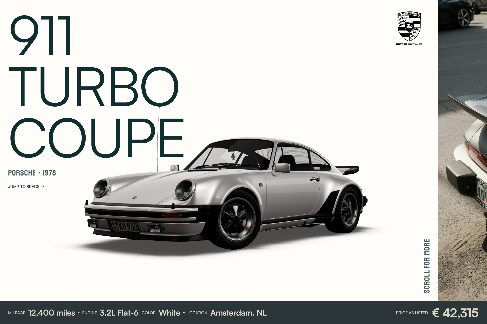

| Element | Position (CSS px at 1440 × 960) | Layer | Notes |
| --- | --- | --- | --- |
| Car name, three lines ("911 / TURBO / COUPE") | x 24, top ≈ 40, cap height ≈ 120 per line, block ≈ 520 wide | Behind | The car's antenna and roofline cross "COUPE": the name sits behind the car. |
| Make · year ("PORSCHE · 1978") | x 24, y ≈ 500 | Behind or front | Small condensed caps. |
| "JUMP TO SPECS →" | x 24, y ≈ 552 | Front | Scrolls to section C. |
| Make emblem | right column, x ≈ 1170, y ≈ 35, ≈ 80 wide | Front | Hero only; current wordmark replaces the crest. |
| 3D car | low side three-quarter, nose left, centred ≈ x 680, ground ≈ y 750, ≈ 840 wide | Canvas | Slow turntable at rest; drag rotates about the vertical axis only. Soft contact shadow. |
| First photo, peeking | from x ≈ 1294 to the edge, full height above the bar | Front | Scroll cue: the start of section A is already in view. |
| "SCROLL FOR MORE" | vertical, x ≈ 1262, bottom-aligned above the bar | Front | Rotated 90°. |
| Bottom spec bar | full width, y ≈ 892–960 (≈ 68 tall), dark | Front | Mileage, engine, colour, location on the left; "Price as listed" and the price on the right. Pinned through the hero and section A. |

**Motion (from the storyboard and the decisions):** the car arrives from the carousel and settles into the
turntable; the name, make, link, emblem and bar reveal in staggered order.

## Frame 2: Section A, photos begin

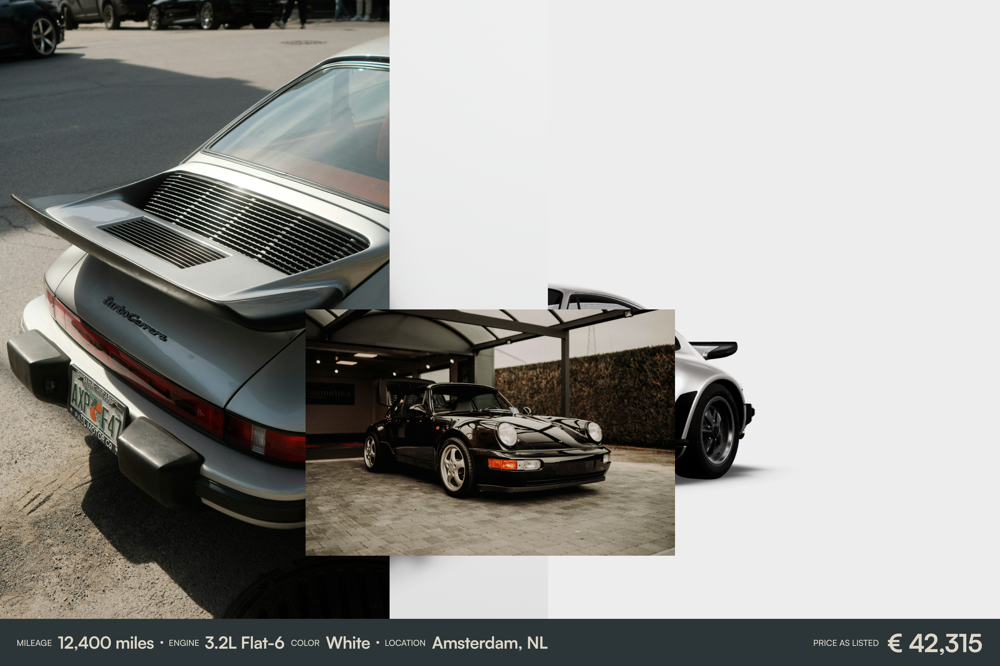

- A large photo fills the left ≈ 560 px of the viewport, full height above the bar (rear three-quarter detail).
- A pale grey vertical band (x ≈ 560–790) and a white area beyond it: the photo layout's background panels.
- A smaller landscape photo (≈ 530 × 355, at x ≈ 440, y ≈ 446) overlaps the large photo's edge and the car: it is in
  the **front** layer and covers the car's rear.
- The 3D car is still in its hero pose, now on the right (≈ x 970–1080 visible), because the content has scrolled
  past it.
- The bottom bar is still pinned.

**Storyboard note:** "Images keep scrolling (maybe 3 or 4 here) in an asymmetric but still on-grid layout. As in
Normal is Boring, use a reveal animation on the smaller image to reveal the other images, so one slot shows several
photos without wasting space." → the image-swap reveal in one slot (`docs/overhaul.md`, research findings).

## Frame 3: End of section A, camera transition starts

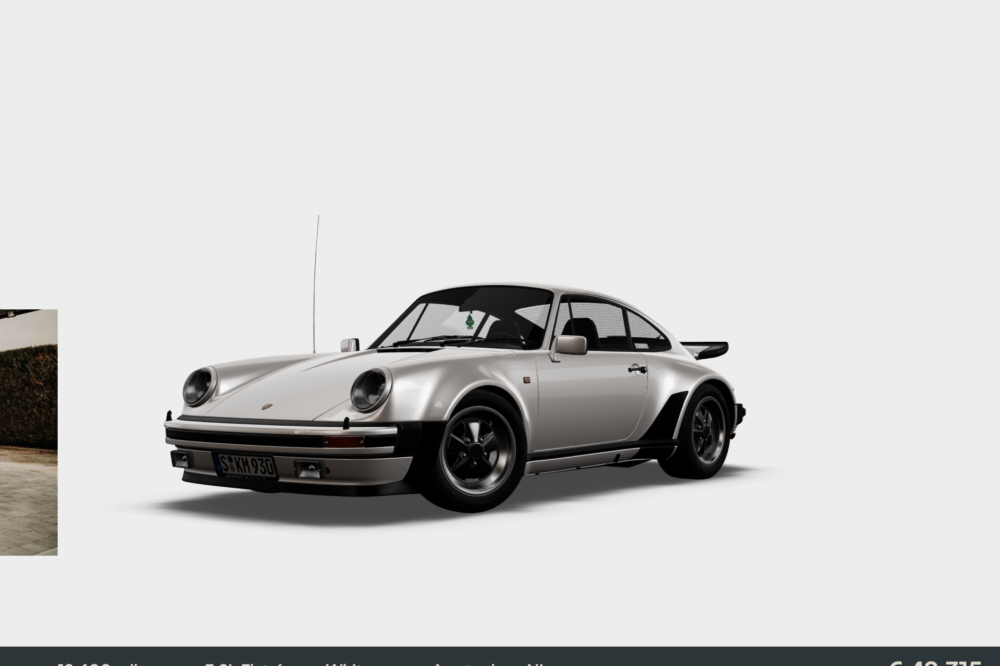

- The last photo of section A is just leaving the viewport on the left (x 0–82 visible).
- The car is alone on a light background, still in the hero pose, centred ≈ x 650.
- The bottom bar is sliding down out of view (only its top edge shows at y ≈ 930).

**Storyboard note:** "At the very end, when the image is only just exiting the grid, start transitioning the camera
from whatever position the turntable is in, and gradually fade the bottom info bar out downwards. On this frame,
transition to a top-down roof view, slightly angled to the right, placed on the left side of the composition. The
checkpoints can simply be the start and end state, but make sure it is seamless (not frame by frame) and reaches the
desired position, angle and zoom."

## Frame 4: Section B, roof view and "About the car"

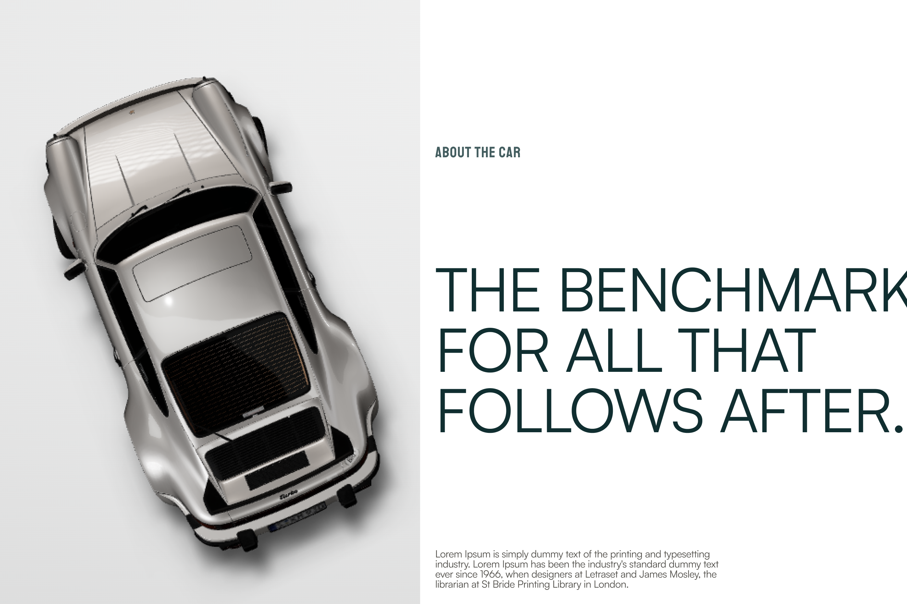

- **Car:** top-down roof view, nose up, rotated slightly counter-clockwise (the nose leans ≈ 10–15° left of vertical), filling the left ≈ 590
  px of the viewport, roughly 70% of the viewport's height in length. Canvas layer, on a pale grey field
  (x 0–667).
- **Right half (white, x ≈ 667–1440):**
  - "ABOUT THE CAR" label, condensed caps, x ≈ 690, y ≈ 240.
  - Headline in three lines ("THE BENCHMARK / FOR ALL THAT / FOLLOWS AFTER."), cap height ≈ 75, x ≈ 690,
    y ≈ 420–690. It runs past the right edge in this frame.
  - Body paragraph, 4 lines, ≈ 450 wide, x ≈ 690, bottom-aligned at y ≈ 935.

**Storyboard note:** "Add general info about the car first. The layout should be magazine-like, a car brochure in the
manner of the German ones from Stuttgart. I still use a 24 px margin on all sides for this section."

## Frame 5: Section B continues

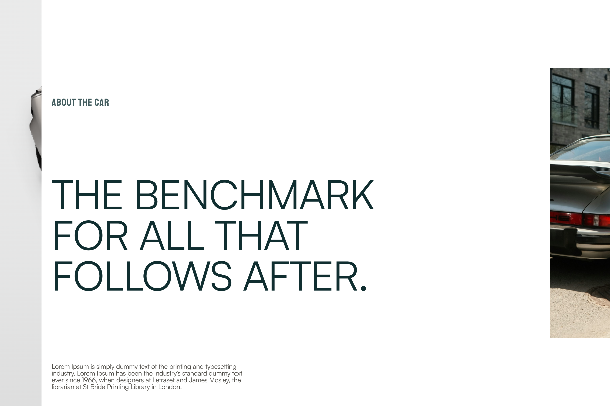

- The roof-view car has moved off to the left (only the edge of the field at x 0–98 remains).
- The "About" block now starts at x ≈ 122: label at y ≈ 240, headline at y ≈ 420–690, paragraph at y ≈ 865–925.
- A tall photo enters on the right (x ≈ 1298), y ≈ 160–800.

**Storyboard note:** "Make sure the next section is always (barely) visible on any screen size, so users always
know there is something after the section, like this one."

## Frame 6: Section B photo, the dark section approaches

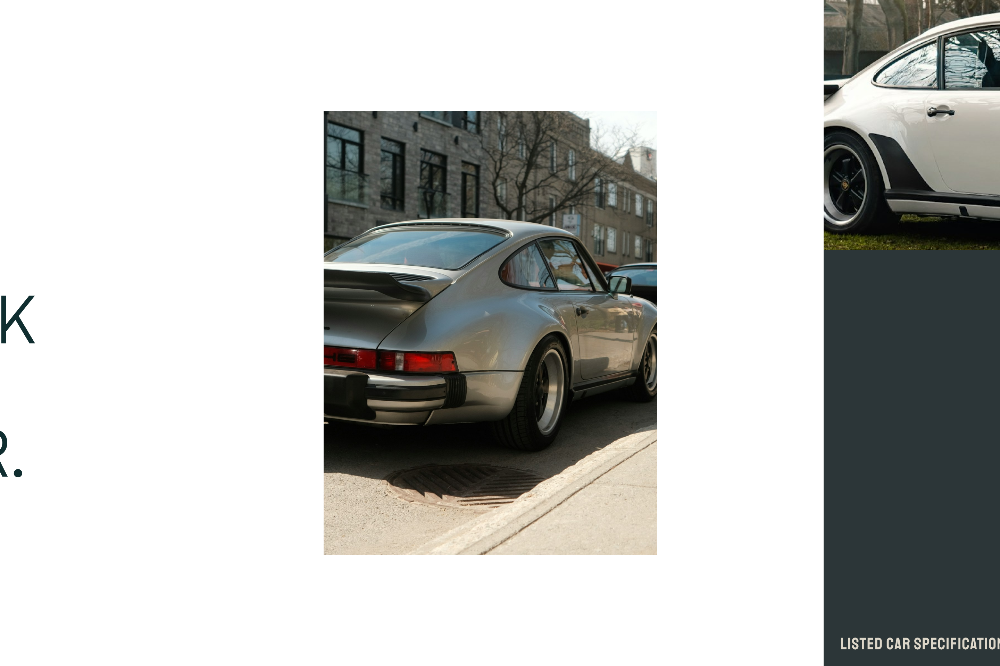

- A 480 × 640 portrait photo, x ≈ 466–945, y ≈ 160–800.
- On the right (x ≈ 1186 onward) the dark specs section enters: a photo across its top ≈ 360 px, dark below, with
  "LISTED CAR SPECIFICATIONS" at the bottom left (y ≈ 928).

**Storyboard notes:** "This image should have another cycled-through reveal animation. It is 480 × 640. Add parallax
if you can to this image (slow the entry) and to the transition into the next section's image as well."

## Frame 7: Section C, specs

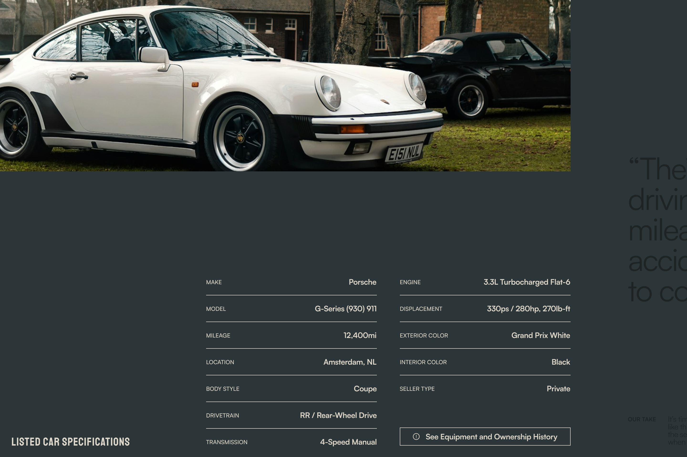

- The dark section fills the viewport (front layer: it covers the car).
- A wide photo across the top: x 0–1196, y 0–360.
- "LISTED CAR SPECIFICATIONS" label: x 24, bottom-aligned at y ≈ 928.
- Spec table in two columns, label left and value right, with hairline rules between rows (row pitch ≈ 56):
  - Left column, x ≈ 432–790: make, model, mileage, location, body style, drivetrain, transmission.
  - Right column, x ≈ 838–1196: engine, power and torque (labelled "Displacement" in the mock by mistake; the
    build lists displacement and power with torque as separate rows),
    exterior colour, interior colour, seller type, and an outlined button "See Equipment and Ownership History".
- The next block's large text is already entering on the right (x ≈ 1316).

**Storyboard note:** "The complete list of specs. The equipment, modifications, flaws, ownership history and so on
should be kept in a button that summons an overlay, designed later." (Overlay is a placeholder for now.)

## Frame 8: Section C, summary, "Our take", "To keep in mind"

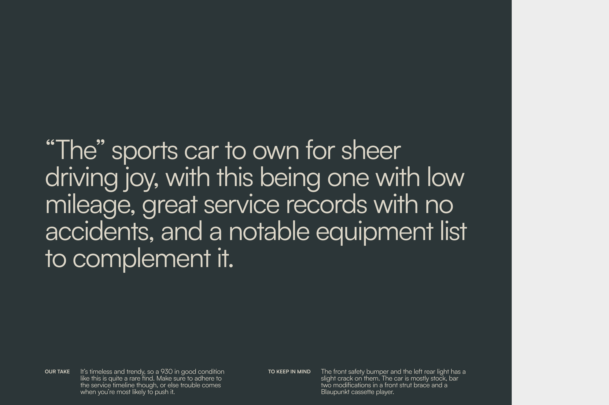

- Still the dark section. A large summary quote, five lines at ≈ 60 px cap height, x ≈ 106–1105, y ≈ 330–640.
- Bottom row at y ≈ 875–935: "OUR TAKE" label (x ≈ 106) with its paragraph (x ≈ 190, ≈ 340 wide), and "TO KEEP IN
  MIND" (x ≈ 634) with its paragraph (x ≈ 758, ≈ 340 wide).
- The light field begins again at x ≈ 1210.

**Storyboard note:** "Notice the darkened text in the previous screen? Make this scroll-to-reveal text like Normal is
Boring's." (Characters brighten from dim to full as the section scrolls in.)

## Frame 9: Dark section leaves, roof view again, camera transition 2

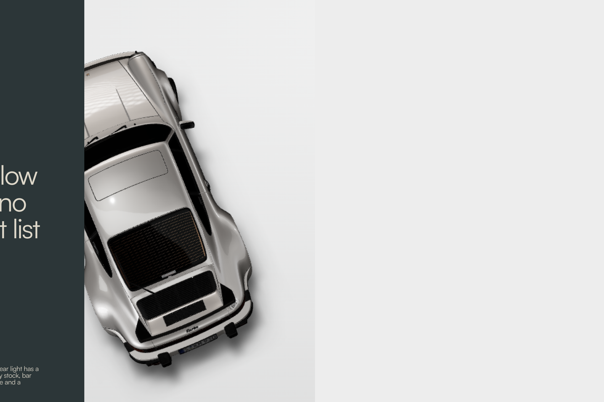

- The dark section is exiting left (x 0–200).
- The car is revealed again in the roof view, left of centre (x ≈ 200–620). It stayed in its pose behind the dark
  section: the section covered it.
- The rest of the viewport is the light field, empty.

**Storyboard note:** "Another 3D transition here, from the roof to the side view. The start trigger is when the dark
section is almost exiting the frame but still has a little of it showing, for continuity."

## Frame 10: Section D, side view and the price comparison

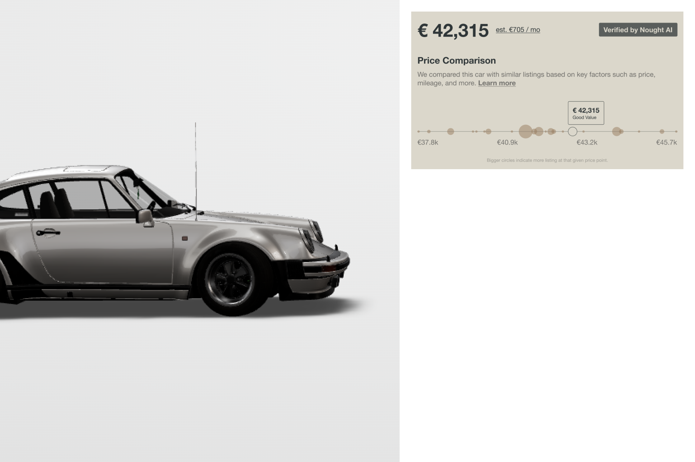

- **Car:** pure side view, nose right. The nose sits at about half the viewport (front bumper at x ≈ 723), about
  three quarters of the body is visible, and the tail is out of frame on the left. Ground at y ≈ 655. Light field
  x 0–827.
- **Price card** (front layer), x ≈ 851–1415, y ≈ 24–350, light background: the price with a monthly estimate, a
  verification badge, a "Price Comparison" heading and a one-line explanation, then a horizontal strip plot of
  comparable listings (bubble size = number of listings at that price; this car marked with an outlined circle and a
  "Good value" tooltip; four axis ticks), and a caption.
- The area below the card (x ≈ 827–1440, y ≈ 350–960) is empty in the mock: room for the further datasets.

**Storyboard notes:** "Compares the car's price with similar marketplaces using interactive data visualisation. The
shape should be similar to the Figma one but adjusted to our design system. This should be a front section with a
light background. Add further datasets below it, but make them clear and useful. The competing marketplaces and all
the data can be fake. From this section onwards it is less designed by the user: propose designs and ask first."

## Frame 11: Photo slideshow begins

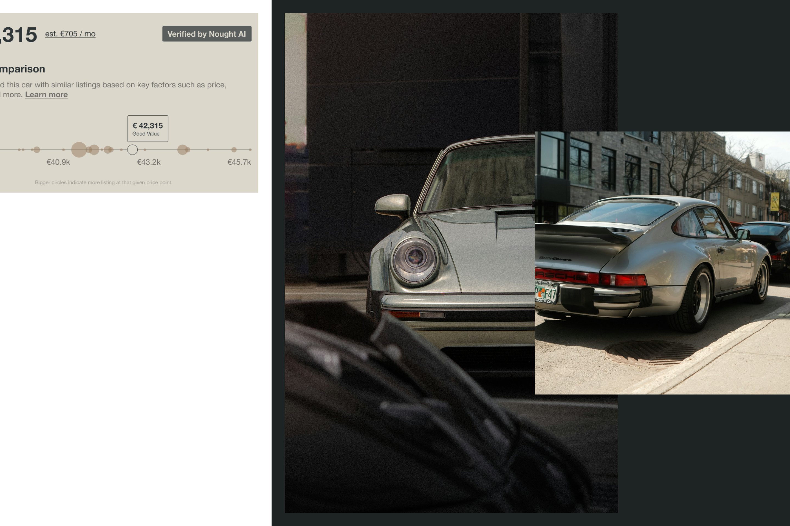

- The price card is leaving on the left.
- A dark section starts at x ≈ 495 (front layer).
- Inside it, a tall photo (x ≈ 519–1126, y ≈ 24–936) and a smaller landscape photo overlapping it to the right
  (x ≈ 975–1440, y ≈ 240–720).

**Storyboard note:** "Transition to an image slideshow with a reveal animation."

## Frame 12: Slideshow continues, link to the gallery

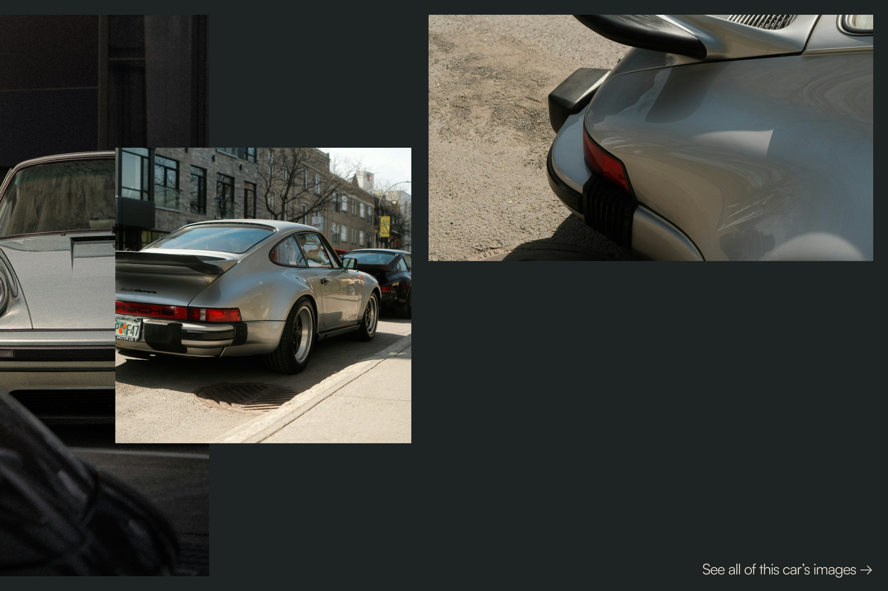

- Dark section across the viewport. The tall photo is on the left (x 0–338), the landscape photo at x ≈ 187–667,
  y ≈ 240–720, and a third photo top right (x ≈ 695–1415, y ≈ 24–424).
- "See all of this car's images →" bottom right (x ≈ 1138, y ≈ 925).

**Storyboard note:** "Add a CTA for the user to see the full list of images and the gallery." (Gallery is a
placeholder for now.)

## Frame 13: Dark section leaves, side view again, camera transition 3

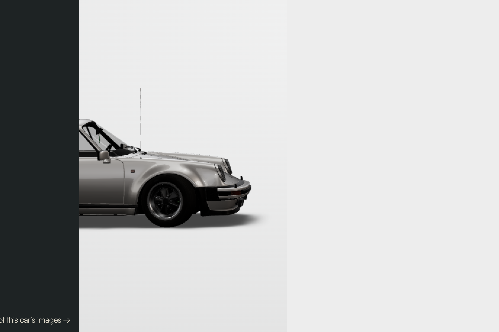

- The dark section is exiting left (x 0–228), with the gallery link still on it.
- The car is revealed in the side view, as in frame 10, on the light field.

**Storyboard note:** "Transition to the CTA with another 3D transition, from the side view to the front nose view.
Simply rotate and zoom. Centre it in the middle of the screen."

## Frame 14: Section E, enquiry

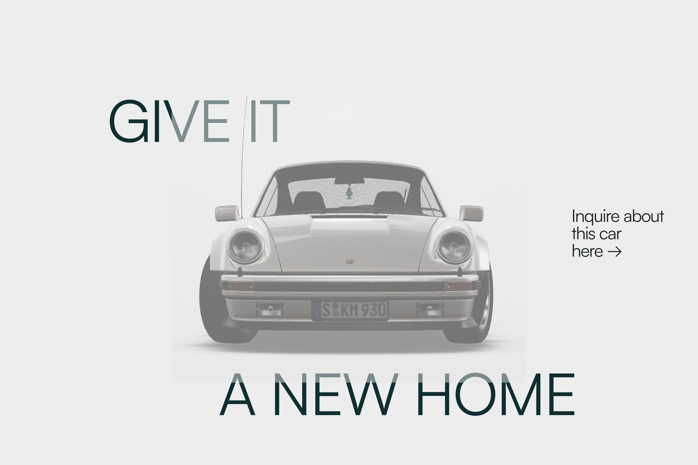

- **Car:** front view, centred (x ≈ 410–1015, ground ≈ y 690), on the light field.
- "GIVE IT" at x ≈ 225, y ≈ 200–295; "A NEW HOME" at x ≈ 450, y ≈ 770–860. Both are **behind** elements at full
  opacity; the car covers them where they overlap. The faded letters in the frame are only a mock artifact (the car
  is a semi-transparent screenshot pasted over the type), confirmed by the user.
- "Inquire about this car here →", three lines, x ≈ 1180, y ≈ 430–530 (front layer).

**Storyboard notes:** "'Give it' comes in from the left with a fade, 'a new home' from the right with a fade. The
enquiry form comes in as a sidebar, either by scrolling far enough or by clicking 'Inquire about this car here →'."
(Form is a placeholder for now, no backend.)

## The camera, frame by frame

| Frames | Pose | Where on screen |
| --- | --- | --- |
| 1–3 | Hero: low side three-quarter, nose left, slow turntable | Centred, ground ≈ 78% down |
| 3 → 4 | Transition 1: rotate up and over to the roof view, move left | Starts as section A's last photo leaves; ends at frame 4 |
| 4–9 | Roof view: top-down, nose up, ≈ 10–15° counter-clockwise | Left of centre; hidden behind the dark section in frames 7–8 |
| 9 → 10 | Transition 2: roof to pure side view, zoom in | Starts as the dark section is almost off screen |
| 10–13 | Side view: nose right at ≈ 50% of the width, tail out of frame | Left half; hidden behind the slideshow section in frames 11–12 |
| 13 → 14 | Transition 3: rotate to the front view and zoom out | Starts as the slideshow section leaves |
| 14 | Front view | Centred |

All three transitions are tied to scroll position (they reverse when scrolling back) and must be smooth, reaching
exactly the target position, angle and zoom.
